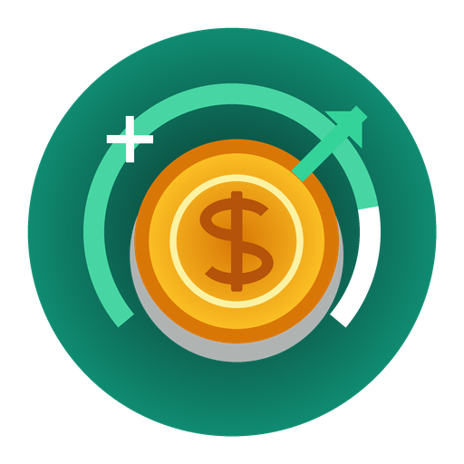

# 🎯 SavingGoalPlus

<p align="center">
  
</p>

<p align="center">
  <strong>A modern, privacy-focused, zero-ads savings goal manager for Android & iOS.</strong><br>
  Built natively with Kotlin & Jetpack Compose (Android) and Swift & SwiftUI (iOS).
</p>

<p align="center">
  <a href="https://github.com/Minta1234/SavingGoalPlus/actions"></a>
  
  
  
  
  <a href="LICENSE"></a>
  
</p>

---

## 📖 Overview

**SavingGoalPlus** is a complete, modern rewrite of the popular Android savings goal tracking concept. Built from the ground up to replace legacy architectures, SavingGoalPlus provides an elegant, distraction-free interface to track and manage personal savings goals without subscriptions, locked features, or invasive analytics.

Every feature from the original concept has been faithfully preserved with 100% mathematical and structural parity, and elevated with modern Android 16 capabilities, particle physics animations, customizable daily reminder notifications, and native widgets.

---

## ✨ Features

- **🎯 Target Goal Management**
  - Create and edit financial goals with custom names, target amounts, and deadline dates.
  - Attach personalized photo covers or auto-generated color initials.
  - Real-time percentage badges and progress metrics.

- **📊 Dynamic 260° Arc Gauge & Projections**
  - Visually track progress on a custom vector arc gauge with smooth fluid sweep animations.
  - Multi-tier dynamic color stages:
    - 🟠 **$\le 30\%$**: Amber / Warming up
    - 🔵 **$31\% - 60\%$**: Cyan / Steady growth
    - 🟢 **$> 60\%$**: Emerald Green / Reaching target
  - Precise daily, weekly, bi-weekly, and monthly required savings projections.

- **💰 Transaction Ledger (Deposits & Withdrawals)**
  - Fast logging of deposits (`+`) and withdrawals (`-`).
  - Add descriptive notes and custom transaction timestamps.
  - Real-time balance recalculation and historical payment log.

- **⏰ Smart Daily Reminders (Notification at Custom Time)**
  - Set a scheduled daily reminder time to stay disciplined.
  - Powered by Android `AlarmManager` with boot receiver support (`RECEIVE_BOOT_COMPLETED`), ensuring notifications persist after device reboots.
  - Native notification channel with priority alerts and in-app test trigger.

- **🎉 Celebratory Confetti Physics Animation**
  - When any savings goal hits 100%, an interactive 2D confetti particle explosion celebrates your financial victory!
  - Realistic physics engine simulating gravitational acceleration, horizontal drag, angular velocity, and random colors.

- **📱 Home Screen AppWidget**
  - Native Android AppWidget showing total saved amount, remaining balance, and active goal count directly on your launcher.

- **🗄️ Completed & Archived Goals**
  - Separate archive section for completed milestones.
  - Keep your main dashboard uncluttered while maintaining full historical records.

- **💾 100% Offline, Privacy & Backup**
  - Fully local SQLite storage with zero cloud dependencies or remote tracking.
  - One-click JSON backup export and import (compatible with legacy SQLite database schemas).
  - One-click CSV export for external spreadsheet analysis in Excel or Google Sheets.

- **🎨 8 iOS-Style Theme Accent Palettes & Custom Branding**
  - Choose from 8 vibrant iOS-inspired accent themes: **Apple Mint, Cupertino Blue, Indigo Night, Rose Pink, Sunset Orange, Pacific Teal, Royal Purple, and Midnight Slate**.
  - Consistent across Android Jetpack Compose and iOS SwiftUI.
  - Custom hand-crafted vector app icon (non-AI, geometric finance vault & growth sprout symbol).

- **🔄 Seamless In-Place Updates & Change Log**
  - Unified permanent release signing keystore ensures every update installs directly over the previous version without requiring uninstallation.
  - Interactive in-app Change Log dialog and 1-click update checker. See [CHANGELOG.md](CHANGELOG.md).

---

## 🛠️ What Was Fixed & Upgraded (Comparison with Legacy App)

| Feature | Legacy App | SavingGoalPlus (v2.0) |
| :--- | :--- | :--- |
| **Architecture** | Obsolete Java (2018), XML Layouts | Modern **Kotlin 2.0 + Jetpack Compose** |
| **Android Version Support** | Outdated API levels | **Android 7.0 (API 24) to Android 16 (API 36)** |
| **Monetization & Ads** | Banner ads, interstitial ads, paywalls | **100% Free, Zero Ads, Zero Paywalls** |
| **Total Summary Dashboard** | Locked behind premium in-app purchase | **Permanently Unlocked & Free** |
| **Celebrations** | Static text | **Dynamic Confetti Particle Physics Animation** |
| **Notifications** | Unreliable background alarms | **Precise `AlarmManager` + Reboot Auto-reschedule** |
| **Home Screen Widget** | Basic legacy remote views | **Refined Modern AppWidget** |
| **Storage & Backup** | Hardcoded internal DB | **StateFlow Reactive SQLite + JSON & CSV Export/Import** |
| **App Icon** | Low-res bitmap | **Vector-drawn multi-density Adaptive Icon** |

---

## 🏗️ Architecture & Tech Stack

- **Language**: Kotlin 2.0.21
- **UI Toolkit**: Jetpack Compose with Material 3 design tokens
- **Target SDK**: Android 16 (API Level 36)
- **Minimum SDK**: Android 7.0 (API Level 24)
- **Concurrency**: Kotlin Coroutines & `StateFlow`
- **Database Engine**: Direct SQLite (`SavingsGoalDbHelper`) with relational schema:
  - `MAINLIST` (Goal entities, targets, dates, metadata)
  - `PAYMENTLIST` (Transaction history, foreign-keyed to goal IDs)
- **Serialization**: `kotlinx.serialization.json`
- **Dependency Management**: Gradle Version Catalog (`gradle/libs.versions.toml`)
- **Unit Testing**: JUnit 4 with comprehensive test suite covering mathematical projection edge-cases.

---

## 🚀 Building & Running from Source

### Prerequisites
- **JDK 17** or **JDK 21** (e.g. Eclipse Adoptium Temurin 21)
- **Android SDK** with Platform API 36 and Build-Tools 36.0.0
- **Git**

### Build Debug APK
```bash
git clone https://github.com/Minta1234/SavingGoalPlus.git
cd SavingGoalPlus
./gradlew assembleDebug
```
The compiled APK will be located at:
`app/build/outputs/apk/debug/app-debug.apk`

### Build Release APK
```bash
./gradlew assembleRelease
```
The signed release APK will be located at:
`app/build/outputs/apk/release/app-release.apk`

### Run Android Unit Tests
```bash
./gradlew testDebugUnitTest
```

### Build & Test iOS App
```bash
cd ios
# Run unit tests
swift test

# Build for iOS Simulator via Xcode
xcodebuild build -project SavingGoalPlus.xcodeproj -scheme SavingGoalPlus -destination 'generic/platform=iOS Simulator'
```

---

## 🔄 Automated CI/CD & Smart Change Detection

The [release workflow](.github/workflows/build-and-release.yml) builds Android and iOS in parallel from the same commit. A relevant push to `main`, version tag push, or manual run publishes one release after both builds succeed. Each release contains the signed Android APK, unsigned iOS IPA, and Xcode archive. Pull requests validate both builds without publishing.

Android uses the existing `RELEASE_KEYSTORE_BASE64` secret. For custom credentials, set `KEYSTORE_PASSWORD`, `KEY_ALIAS`, and `KEY_PASSWORD`. The unsigned iOS IPA must be signed before installation.

SHA-256 checksums are shown in each release description and included in `SHA256SUMS.txt`. Download it alongside the packages and run `sha256sum -c SHA256SUMS.txt` on Linux or `shasum -a 256 -c SHA256SUMS.txt` on macOS. On Windows, run `Get-FileHash -Algorithm SHA256 <filename>` in PowerShell and compare the hash with the matching line in the checksum file.

---

## 👥 Contributors

* **[Minta1234](https://github.com/Minta1234)** — Project Creator, Lead Developer & Maintainer.
* **[Antigravity](https://github.com/google-deepmind)** (Google DeepMind) — Advanced AI Pair Programmer & Systems Architect (system architecture, modern Kotlin & Jetpack Compose rewrite, SQLite data layer, 260° arc gauge, confetti physics engine, notification alarms, and CI/CD automation).

See [CONTRIBUTORS.md](CONTRIBUTORS.md) for full project attribution.

---

## 📄 License

This project is open-source and released under the terms of the **[MIT License](LICENSE)**.

```
Copyright (c) 2026 Minta1234
```

